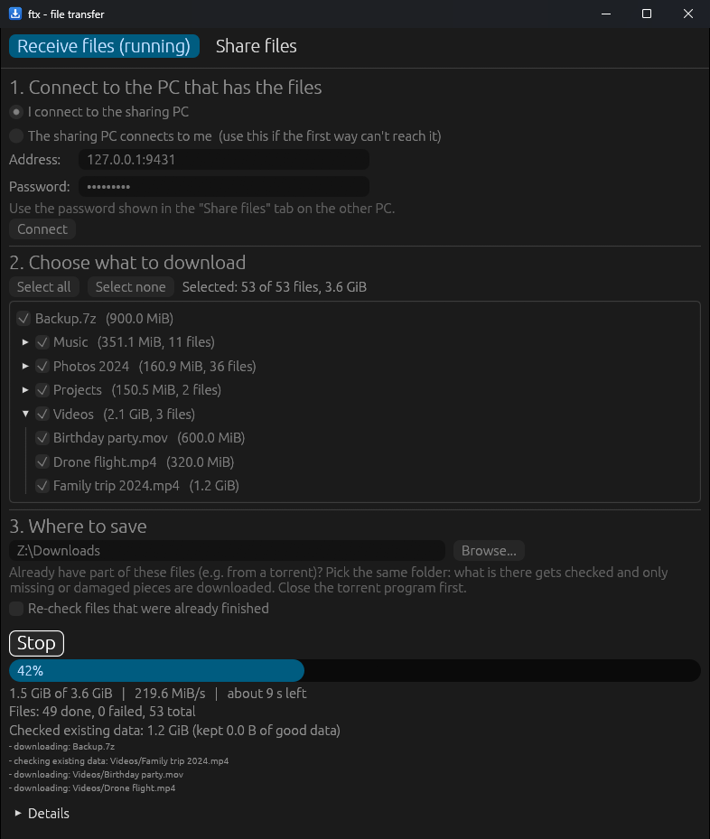
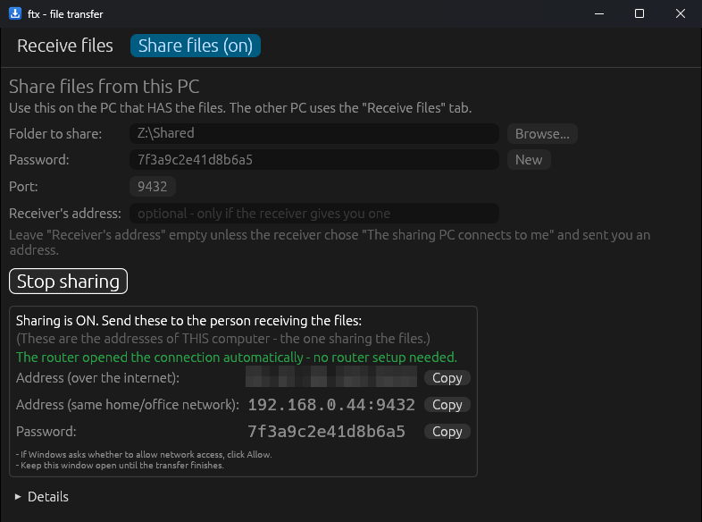
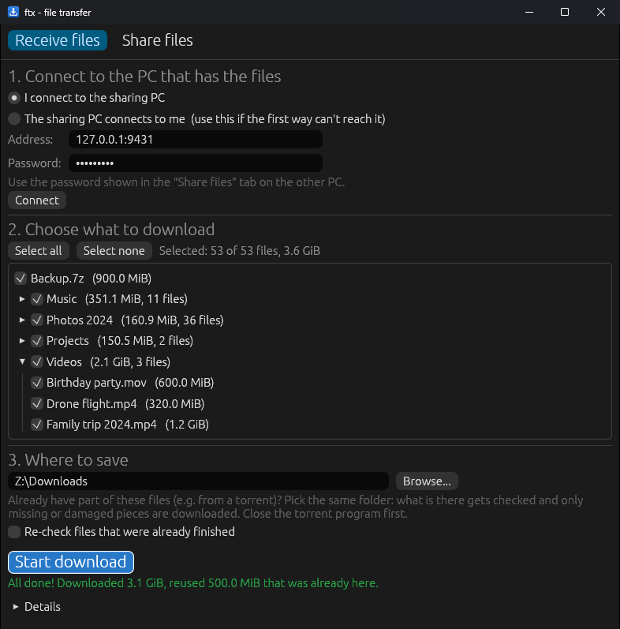
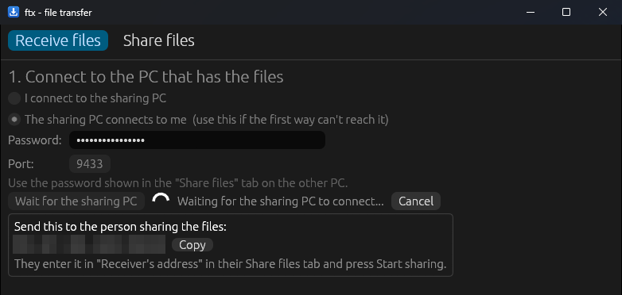
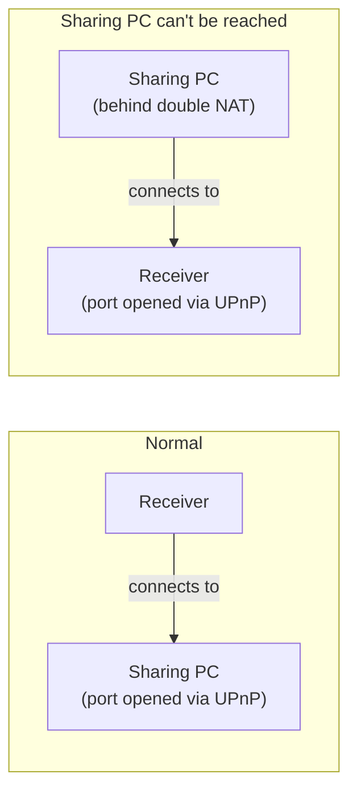

<p align="center">
  
</p>

<h1 align="center">ftx</h1>

<p align="center">
  <b>Move hundreds of gigabytes from one PC to another — over the internet, resumable, verified, no router setup.</b>
</p>

<p align="center">
  <a href="https://github.com/antoxa2584x/ftx/actions/workflows/build.yml"></a>
  <a href="https://github.com/antoxa2584x/ftx/releases/latest"></a>
  
  <a href="LICENSE.md"></a>
</p>

<p align="center">
  
</p>

---

**ftx** is a single small program with two buttons' worth of UI: one person presses **Share files**, the other presses **Receive files**, ticks what they want, and the files arrive — checked piece by piece. If the connection drops, the PC sleeps, or you stop it, press Start again and it continues where it left off.

It was written to finish a 400 GB transfer that a torrent had half-done: point ftx at the same folder and it **checks what's already there and downloads only the missing or damaged pieces**.

## Features

- 🖱️ **Made for non-technical people** — a window with numbered steps, copy buttons and plain-language messages. No accounts, no cloud, no installer.
- 🔁 **Resumable** — stop, reboot, lose Wi-Fi; press Start again and nothing already received is downloaded twice.
- ✅ **Verified** — every 4 MiB piece is checked with BLAKE3 on arrival; a damaged piece is fetched again.
- 🧲 **Continues torrent downloads** — adopts half-finished files (`.!qB`, `.!ut`, `.part`, …), keeps the good pieces, fetches the rest.
- 🌍 **Works across the internet without touching the router** — opens the port with UPnP, like torrent clients do.
- 🔄 **Works even when the sharing PC can't be reached** (double NAT, mobile/CGNAT internet, office networks) — the sharing PC can *connect out* to the receiver instead.
- ⚡ **Fast** — several files in parallel, local and remote checking at the same time.
- 🔐 **Password never travels over the network** — both PCs prove they know it with a challenge–response login.
- 💻 **Windows, macOS and Linux**, plus a command line for scripts and servers.

## Download

Grab the file for your system from the [**latest release**](https://github.com/antoxa2584x/ftx/releases/latest):

| System | File | How to start |
|---|---|---|
| Windows 10/11 | `ftx-windows-x86_64.exe` | Double-click. If SmartScreen warns, click *More info → Run anyway*. |
| macOS 11+ (Intel & Apple Silicon) | `ftx-macos-universal.zip` | Unzip, then **right-click `ftx.app` → Open** the first time (the app isn't notarized; on macOS 15 use *System Settings → Privacy & Security → Open Anyway*). |
| Linux x86_64 | `ftx-linux-x86_64.tar.gz` | `tar xzf ftx-linux-x86_64.tar.gz && ./ftx` |

Both PCs must run the **same version** of ftx.

## How to use

### 1. On the PC that has the files — *Share files*

Choose the folder, press **Start sharing**, and send the other person the **address** and **password** shown (each has a *Copy* button).

<p align="center"></p>

### 2. On the PC that receives — *Receive files*

1. Paste the address and password, press **Connect**.
2. Tick the folders and files you want.
3. Choose where to save them — **if part of the data is already there (e.g. from a torrent), choose that same folder**.
4. Press **Start download**.

<p align="center"></p>

### If the receiver can't connect — let the sharing PC connect instead

Some internet connections can't accept incoming connections at all (the sharing PC shows *"the router's own address … is not public"*). In that case flip the direction:

1. **Receiver:** choose **"The sharing PC connects to me"**, enter the password, press **Wait for the sharing PC**, and send the address that appears.
2. **Sharing PC:** paste it into **Receiver's address** and press **Start sharing**.

The file list shows up on the receiver within a few seconds, and everything else works the same way.

<p align="center"></p>



> Files always flow from the sharing PC to the receiver — only *who opens the connection* changes. At least one of the two PCs must be reachable; if neither router supports UPnP, forward the port manually on one of them, or put both PCs on a VPN such as Tailscale and use its addresses.

## How it works

1. The sharing PC lists the chosen folder; the receiver picks files.
2. For every file that already exists on the receiver (or a torrent's half-finished copy), **both sides hash it in 4 MiB chunks at the same time** and compare. Only chunks that are missing or different are requested.
3. Each chunk arrives with its BLAKE3 hash and is checked before it's written.
4. Finished files are recorded in `.ftx-done` in the destination folder, so the next run skips them instantly (tick *Re-check files that were already finished* to verify them again).
5. If the connection breaks, each worker reconnects and continues from the last chunk it wrote.

## Command line

Run `ftx` with no arguments for the window; with arguments it's a CLI. The password can also come from the `FTX_TOKEN` environment variable.

```sh
# on the PC with the files
ftx serve /data/share --token s3cret                    # listens on 0.0.0.0:9000

# on the receiving PC
ftx list 203.0.113.5 --token s3cret                     # what's shared (top-level summary)
ftx get  203.0.113.5 --dest ~/Downloads/share --token s3cret
ftx get  203.0.113.5 --dest D:\share --pick             # choose top-level items interactively
ftx get  203.0.113.5 --dest D:\share --include "Videos/*" --exclude "*.tmp" -j 8

# reverse direction (sharing PC can't be reached)
ftx get --wait 9001 --dest D:\share --token s3cret      # receiver waits on port 9001
ftx serve /data/share --token s3cret --connect 198.51.100.7:9001
```

| Option | Meaning |
|---|---|
| `--dest DIR` | Where to save; existing data there is verified and reused |
| `--pick` | Choose top-level folders/files interactively |
| `--include GLOB` / `--exclude GLOB` | Filter paths (repeatable, case-insensitive) |
| `-j, --jobs N` | Files transferred in parallel (default 4) |
| `--recheck` | Verify files already recorded as finished |
| `--wait PORT` | Receive by waiting for the sharing PC to connect in |
| `serve --connect HOST:PORT` | Also connect out to a waiting receiver |
| `serve --bind ADDR` | Listen address (default `0.0.0.0:9000`) |

## Security notes

- The password is **never sent**: each connection starts with a mutual challenge–response (BLAKE3 keyed hashes over random nonces), and the side that opened the connection proves itself first, so someone scanning an open port learns nothing.
- Paths are confined to the shared folder and the destination folder; `..` and absolute paths are rejected.
- **The file data itself is not encrypted.** It is checked for integrity, but someone who can watch the network path could see it. For sensitive data, run ftx over a VPN (Tailscale, WireGuard, …).
- The generated passwords are 16 random hex characters; if you type your own, make it long.
- Settings (including passwords) are stored in plain text in `%APPDATA%\ftx`, `~/Library/Application Support/ftx` or `~/.config/ftx`.

## Building from source

Requires a recent stable [Rust](https://rustup.rs) (edition 2024).

```sh
cargo build --release          # → target/release/ftx(.exe)
```

Linux needs no extra development packages; at runtime it uses X11 or Wayland and the XDG desktop portal for folder pickers. The macOS `.app` bundle and all release files are produced by [`.github/workflows/build.yml`](.github/workflows/build.yml) — push a tag like `v0.1.0` to publish a release.

## License

[PolyForm Noncommercial 1.0.0](LICENSE.md) — free to use, modify and share for any **non-commercial** purpose (personal use, education, research, charities, …). Commercial use requires a separate license from the author.

Required Notice: Copyright (c) 2026 antoxa2584x (https://github.com/antoxa2584x/ftx)
